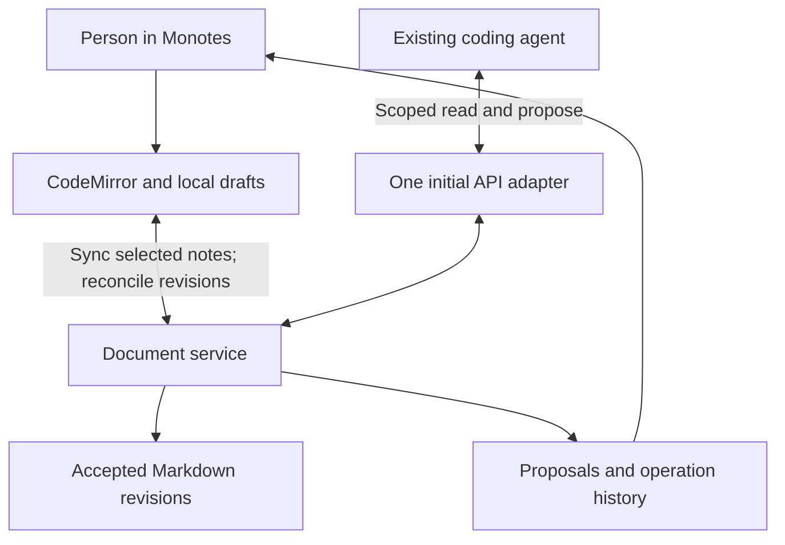

Monotes: an agent-native direction, researched 14 October 2026

**Recommendation:** develop Monotes into a personal Markdown workspace that existing coding agents can use through a small, permissioned interface. Preserve the writing experience. Start with reading selected notes and submitting reviewable edits; introduce automatic writes only after version checks, synchronization, and recovery are reliable. Full Scribe feature parity is a much larger product expansion and is not necessary to deliver this value.

The user prioritizes personal notes with existing coding agents and has not chosen between cloud and local-file storage. The recommendation below is conditional and explains what would change it. Effort estimates are engineering judgments, not measured benchmarks or commitments.

**Research scope and confidence.** Inspected the Monotes checkout at `/Users/abhi/dev/monotes`, baseline commit `53edb00141b083697580c5f03f5ff75c6b6559b0`, initially clean. Read Scribe's public product pages, documentation, changelog, agent skill, live OpenAPI specification, and public skill repository; inspected its live browser sandbox. No Scribe account was created, no authenticated feature was exercised, and no remote data was changed. Application implementation and tests were not changed or run. This is research, so the automatic T3 implementation-review policy does not apply.

**What “agent-native” should mean for Monotes.** An agent should be able to discover an approved note, understand its current content and revision, propose a specific change, and observe whether the user accepted it. The person should see who changed what, retain control over access, and recover from mistakes. An embedded chat window is optional. A useful first workflow is: “Read my project plan, compare it with the code you just changed, and propose an update to the plan.” The coding agent already supplies the code context and model execution; Monotes supplies the persistent writing surface.

This creates several potential advantages:

- Less copying between notes and coding conversations; results return to the place where the plan lives.
- Continuity across agents and sessions through user-controlled notes, instead of relying entirely on a particular conversation's memory.
- Useful maintenance work: progress updates, decision logs, research summaries, draft specifications, and unresolved-question lists.
- A visible review boundary: the user can inspect proposed edits instead of trusting unexplained changes.
- Provider flexibility. Monotes can support an interface used by multiple agents without implementing model selection, inference billing, and a general agent runtime itself. Existing agents retain their own costs and limits; infrastructure and integration still cost money.
- A narrower product identity than a general team document suite: fast personal writing plus dependable external automation.

These benefits depend on adoption and reliability; adding an API alone does not establish them.

**Three distinctions clarify the storage decision.** Local-first means writing remains responsive and can continue without a connection. Local-only means note storage does not require a hosted service. Filesystem-native means notes are actual files such as `~/Notes/project-plan.md`. Monotes currently has browser-local storage; that is different from an ordinary Markdown folder. IndexedDB is origin-scoped browser storage, and a remote agent endpoint cannot reach an unpublished browser note. [IndexedDB reference](https://developer.mozilla.org/en-US/docs/Web/API/IndexedDB_API)

Local file storage also does not imply that AI processing stays on the Mac. If a coding agent uses a hosted model, the context it sends may leave the device. Keeping both storage and inference local requires a separate local-model choice.

| Proposed architecture | Where accepted content lives | What an agent sees with Monotes closed | Other devices | Main engineering responsibility |
| --- | --- | --- | --- | --- |
| Selected cloud notes | Server revisions for selected notes; browser cache and pending local drafts; other notes remain local | Last synchronized version, while the service and agent have network access | Natural extension of a hosted service, once download/reconciliation is built | Permissions, incoming updates, offline outbox, conflicts, account separation |
| Local Markdown folder | Actual `.md` files as the authority; app cache is derived | Saved files on the same machine, if the agent has filesystem access | Requires a separate synchronization design | File access, watching external edits, atomic saves, renames/deletes, conflict recovery, app distribution |
| Explicit export/import | Existing browser notes; exported files are snapshots | Exported snapshot only | Manual transfer or a separate file-sync product | Clear freshness labels and safe import/review |

For example, with selected cloud notes, the agent can update a proposal while the browser is closed. When Monotes opens, it retrieves that proposal. If the user was writing offline, those unsynchronized changes must be reconciled before acceptance. With a Markdown folder, the agent can read and edit the saved file immediately, but Monotes must detect the external write without overwriting an unsaved buffer. Both designs need concurrency rules; cloud and files merely put the problem in different places.

**My provisional choice is selected cloud notes, with an export/import experiment first if needed.** This preserves more of the existing web application and gives a useful closed-browser agent workflow without a new desktop runtime. Keep agent access an explicit per-note or per-collection choice. Treat local-only notes as inaccessible to remote agents. A durable service revision should govern accepted cloud content; the browser keeps pending edits and records their base revision.

Choose a Markdown folder instead if the desired promise is “these are ordinary files on my machine; I can use Git, grep, any editor, and a coding agent directly.” That is a strong direction, but it should be chosen deliberately before investing deeply in cloud collaboration. A desktop companion or local service may then be justified. Browser directory access can support a narrower experiment, but browser support and permission behavior vary; origin-private filesystem storage still does not create a normal folder agents can read. [Directory access](https://developer.mozilla.org/en-US/docs/Web/API/Window/showDirectoryPicker), [origin-private filesystem](https://developer.mozilla.org/en-US/docs/Web/API/File_System_API/Origin_private_file_system)

Avoid starting with independently writable files, IndexedDB, and cloud content all treated as authorities. That produces three copies with competing changes. Pick the authority for each note mode and make every other representation a cache, pending draft, or explicit export.

**What Scribe establishes, and what remains uncertain.** Its documented agent integration uses REST plus an installable skill and named API-key credentials. The skill teaches an existing agent how to operate the service; it does not supply a model runtime. No general document MCP server was identified in the reviewed public integration material. A Monotes MCP connection would be our implementation choice. [Scribe agents](https://scribe.skeptrune.com/docs/agents), [public skill repository](https://github.com/skeptrunedev/scribe-skill)

The important write contract is version-aware: reading returns a document version, and PATCH sends edited Markdown against that base. The server applies the difference into the live document. Expired bases require another read and a recalculated edit. Unconditional PUT remains a replacement; conditional PUT can reject stale versions. These are documented API semantics, not a concurrent-edit guarantee independently tested here. [Content read](https://scribe.skeptrune.com/docs/api-reference/content/get-document-content), [merge contract](https://scribe.skeptrune.com/docs/api-reference/content/merge-document-content.md), [replacement contract](https://scribe.skeptrune.com/docs/api-reference/content/replace-document-content.md)

Scribe's architecture documentation has drifted. It describes a React/Vite application with ProseMirror/Yjs, Cloudflare document sessions, D1, R2, and WorkOS. However, the inspected live sandbox exposes CodeMirror editor markup, and the live schema explicitly names a CM6 migration and threads left over from ProseMirror. Therefore an editor rewrite is not supported by the evidence. The current authenticated editor and exact current collaboration implementation were not source-audited. [Development guide](https://scribe.skeptrune.com/docs/development), [live sandbox](https://scribe.skeptrune.com/sandbox), [live schema](https://scribe.skeptrune.com/openapi.json)

Its older comments guide describes anchored threads, replacement proposals, tracked suggestions, and roles. It also discloses editor-only enforcement for suggesting mode and an inconsistency between undo and accepted-thread status. Given the editor migration, treat those as documented caveats requiring current verification, rather than newly demonstrated vulnerabilities. API replacement proposals are the more conservative capability to use as inspiration. [Comments and sharing](https://scribe.skeptrune.com/docs/collaboration/comments)

The live schema contains 74 operations across 53 paths, including internal administration. Beyond note CRUD, it declares edit-session versions, PDF/DOCX and account ZIP exports, image/video attachments, a dictionary, and optional AI-text detection. The detector may be unconfigured. Schema presence does not prove UI availability or operational quality. No explicit selective-revert endpoint was identified. The linked application repository was unavailable publicly; MIT metadata on the API does not establish availability or licensing of the complete app. [Live schema](https://scribe.skeptrune.com/openapi.json), [linked application repository](https://github.com/mintlify/scribe)

**Monotes has an appropriate editor but an unfinished shared-data layer.** These observations come from implementation inspection, not marketing text:

| Existing foundation or gap | Evidence | Consequence for agent access |
| --- | --- | --- |
| Plain Markdown, CodeMirror, Vim and editor preferences | [Editor](/Users/abhi/dev/monotes/src/components/notes/notes-editor.tsx:109) | Keep these for the first release; agent interoperability does not require rich text. |
| Dexie notes, draft recovery, same-browser revision arbitration | [Local model](/Users/abhi/dev/monotes/src/lib/local-db.ts:3), [draft revisions](/Users/abhi/dev/monotes/src/lib/local-drafts.ts:12) | Valuable local UX; revision arbitration chooses a whole-note winner and does not merge text. |
| Convex user authentication and owner-scoped note records | [Cloud schema](/Users/abhi/dev/monotes/convex/schema.ts:13) | Reuse the backend, but add connection identities, grants, history and proposals. |
| Whole-note cloud replacement without expected revision | [Upload mutation](/Users/abhi/dev/monotes/convex/notes.ts:29), [update mutation](/Users/abhi/dev/monotes/convex/notes.ts:152) | Direct agent writes would be unsafe until the write protocol changes. |
| Current editor consumes local state; cloud get/list hooks have no active hydration consumers | [Editor data path](/Users/abhi/dev/monotes/src/components/notes/notes-editor.tsx:25), [cloud hooks](/Users/abhi/dev/monotes/src/lib/cloud-notes.ts:97) | An agent-created cloud note is not automatically available in the local editor today. |
| Three-second debounced upload, with no durable reconnect outbox | [Sync engine](/Users/abhi/dev/monotes/src/lib/sync-engine.ts:49) | Need explicit pending/synced/conflicted states and durable retry behavior. |
| UI deletion acts on local storage; separate cloud delete hook is not wired into it | [Sidebar deletion](/Users/abhi/dev/monotes/src/components/notes/notes-sidebar.tsx:153), [cloud deletion](/Users/abhi/dev/monotes/src/lib/cloud-notes.ts:121) | Unify lifecycle before agents can read deleted or apparently revoked notes. |
| One browser database without owner partition on local notes | [Local model](/Users/abhi/dev/monotes/src/lib/local-db.ts:8) | Account switching and linking anonymous notes need explicit handling. |
| Search currently filters collected note content | [Cloud search](/Users/abhi/dev/monotes/convex/notes.ts:101) | Add scope-aware pagination/indexing as the corpus grows; semantic search is optional. |
| AI SDK dependencies, but no active agent runtime, application API or MCP service | [Dependencies](/Users/abhi/dev/monotes/package.json:13), [HTTP router](/Users/abhi/dev/monotes/convex/http.ts:1) | Installed packages do not make AI integration implemented. |
| Local persistence browser tests; authenticated cloud behavior not covered | [Test scope](/Users/abhi/dev/monotes/tests/README.md:42) | Add real cloud and concurrency verification when implementation starts. |

Offline editing after the app has loaded is distinct from a guaranteed offline startup or reload. The test documentation explicitly makes this distinction; do not advertise complete offline availability until the app shell and reload behavior support it. [Offline test limitations](/Users/abhi/dev/monotes/tests/README.md:44)

**Feature-by-feature feasibility.** Difficulty is relative to this checkout, with foundational work shared across rows. The table assesses building equivalent capability in Monotes; it does not assume Scribe exposes an embeddable implementation library.

| Reference capability | Work required in Monotes | Difficulty | Priority for personal-agent use |
| --- | --- | --- | --- |
| Markdown writing, keyboard workflows, find/folding | Preserve current editor; polish gaps | Low | Retain |
| Rendered and split preview | Renderer, layout, safe links/content, supported Markdown agreement | Low–medium | Useful; independent of agents |
| Agent reads/searches notes | Scoped service API, connection credentials, clear snapshots/revisions | Medium | First |
| Agent creates notes | Allowed destination, ownership, idempotency, browser hydration | Medium | Early |
| Agent proposes changes | Base revision, stored patch/proposal, diff, accept/reject/conflict | Medium | First meaningful write workflow |
| Safe direct writes | Atomic revision checking, outbox/reconcile, history, error/retry semantics | Medium–high | After proposals |
| Agent identity/activity | Server-derived identity and durable operation records | Medium | Early |
| Persistent per-span AI highlighting | Track provenance through later human edits, replacements and undo | High | Later; activity is simpler |
| Version history and recovery | Stored revisions, retention, restore as a new version | Medium | Before broad automatic writes |
| Note-level discussions | Thread records and permissions | Medium | Optional early |
| Comments attached to moving text | Anchor mapping, ambiguous matches, deleted text and offline edits | High | Later |
| Full tracked-change editing | Insert/delete marks, overlapping suggestions, accept/reject/undo consistency | High | Defer |
| Simultaneous human/agent typing | Shared operation protocol or CRDT, persistence, awareness, reconnect | High | Only after demonstrated demand |
| Team workspaces and sharing | Membership, roles, invitations, all-path authorization | High | Separate product expansion |
| Public read-only links | Revocable tokens, safe rendering, asset exposure rules | Medium | Low priority |
| Folders, titles, organization | Data model, navigation, moves and scoped destinations | Medium | Small collections may help agent scope |
| Markdown import/export | File operations and safe review on import | Low | Early portability feature |
| PDF/DOCX and bulk exports | Rendering pipeline, layout fidelity, images, large-document handling | Medium–high | Later |
| Images/video attachments | Storage, authorization, lifecycle, limits, safe presentation | Medium–high | Later |
| Spelling dictionary | Editor integration and dictionary persistence | Low–medium | Independent polish |
| AI-authorship detection | Provider integration and uncertain classification | Medium | Skip for this objective; log actual agent provenance |
| Desktop macOS/Linux distribution | Shell/companion, signing, installation, updates, OS testing | High for production quality | Only if local files justify it |

The preview/editor descriptions are documented in the [Markdown guide](https://scribe.skeptrune.com/docs/editor/markdown) and [changelog](https://scribe.skeptrune.com/changelog); parts precede the editor migration. Presence, attribution and per-user undo are described in [realtime documentation](https://scribe.skeptrune.com/docs/collaboration/realtime). Desktop distributions are described in the [desktop guide](https://scribe.skeptrune.com/docs/desktop). Supplemental feature rows reflect the live schema, not authenticated testing.

**An architecture that keeps the first release manageable.** Retain Next.js/React, CodeMirror, Dexie and Convex for the selected-cloud path. Introduce a document service that owns authorization, revisions, proposals, accepted operations and lifecycle. UI actions and agent adapters must obey the same semantics. This does not mean a local offline save must wait for the server: local edits remain provisional until reconciled with their server base.

Convex HTTP actions can call queries and mutations, so a replacement backend is not required. SDK/runtime compatibility still needs checking when selecting an MCP transport; do not assume a Node-oriented SDK can run unchanged inside a Convex HTTP action. Database transactions alone do not prevent an application from accepting an obsolete whole-note payload. [Convex HTTP actions](https://docs.convex.dev/functions/http-actions), [Convex concurrency model](https://docs.convex.dev/database/advanced/occ)

A small initial contract could expose `search_notes`, `read_note`, `create_note`, `propose_edit`, and `get_proposal`. Reads return Markdown, an explicit revision and freshness. Proposals carry their base revision, intended patch, explanation and retry identifier. The server determines the actor from the credential. Before accepting, the initiating browser reconciles its pending local edits; the server atomically checks the expected revision. A stale proposal requires refreshed review. The server cannot see another device's disconnected draft: that device must preserve its draft and surface a conflict when reconnecting. Retried submissions and repeated acceptance must not duplicate changes.

Choose one agent-facing interface first. A CLI plus workflow skill is convenient for terminal agents; an MCP server makes tools discoverable in compatible clients; REST is the underlying service interface, not necessarily an extra user-facing product. They should adapt the same semantics instead of becoming separate implementations. For a personal trial, a revocable app-specific credential through a local adapter is simpler than public OAuth onboarding. A broadly distributed remote MCP connection requires appropriate authorization discovery, resource/audience validation and scopes; existing Google sign-in does not provide that automatically. [MCP authorization](https://modelcontextprotocol.io/specification/2026-07-28/basic/authorization)

**The hardest problems are data integrity and trust.** Consider this sequence: the agent reads a plan, the person changes its deadline offline, the agent submits an edited copy, and the browser later uploads its own copy. Serializing database writes does not resolve whose intentions survive. Initially, retain both the user's changes and the proposed edit and require an explicit updated review. Automatic merging can come later.

Store durable history separately from transient revision tokens and editor undo. Restoring an old snapshot can erase later human edits, so show a diff and record restoration as a new revision. Selectively undoing one agent's contributions amid subsequent edits is harder than restoring a version. Similarly, begin with note-level comments or revision-bound quotes; fixed character offsets are not durable anchors.

Scope must apply to every access path: listing, search snippets, direct reads, exports, historical content and attachments. Let users revoke a connection and select read/propose/write permissions. Keep credential administration and publishing separate from content editing. Scribe's key-creation reference allows edit keys to mint descendants that survive parent revocation; that is a design we should narrow. [Scribe key creation](https://scribe.skeptrune.com/docs/api-reference/api-keys/create-an-api-key)

Treat retrieved note text as data, rather than letting it define privileged instructions for the connected agent. Use request limits, bounded content sizes and durable retry IDs. Long agent-generated documents also increase indexing, history and local-write costs. A hosted agent interface does not itself schedule or run agents: unattended automation requires an existing agent runner or a separately built job system.

**Live collaboration remains possible without replacing CodeMirror.** CodeMirror provides collaboration primitives using a central authority, and Yjs offers a CodeMirror binding. Neither removes the need for permissions, persistence, reconnect behavior or recovery testing. CRDTs make replicas converge; they do not ensure two competing rewrites produce sensible prose. [CodeMirror collaboration](https://github.com/codemirror/website/blob/main/site/examples/collab/index.md), [Yjs CodeMirror binding](https://github.com/yjs/y-codemirror.next)

If rich text later becomes essential, evaluate a schema and migration separately. The Convex ProseMirror sync component is not a drop-in preservation of current offline behavior: its source documents unsupported presence/Yjs/offline peer synchronization and remaining durable-cache work. Verify source limitations rather than assuming a component name supplies every feature. [Component source](https://github.com/get-convex/prosemirror-sync)

**A staged plan makes the decision testable.** Estimates assume one experienced full-time engineer familiar with this stack, reusable deployment/authentication, a small beta, and no enterprise/team/billing requirements. The estimates overlap and should not be summed feature by feature.

| Stage | Deliverable and learning goal | Indicative effort |
| --- | --- | --- |
| Workflow experiment | Export a selected note, have an existing agent propose a useful revision, review/import it. Learn whether the workflow is valuable before deeper storage work. | A few days |
| Constrained connected alpha | One agent client, selected online notes, scoped read/search and proposal submission; explicit freshness and constrained review rules | About 2–4 weeks overall |
| Dependable personal beta | Durable proposals/history, safe acceptance, incoming sync, outbox/reconnect, deletion/account separation, recovery and real concurrency tests | About 4–8 weeks overall, including the alpha |
| Trusted direct editing | Explicit write permission, robust conflict/retry behavior, action visibility and recovery | Roughly 1–3 additional weeks, depending on beta foundations |
| Broad Scribe-like product | Live coediting, moving comments, richer suggestions, teams, sharing, exports, attachments, desktop and ongoing hardening | Roughly 4–8+ months overall; rescope after experiments |

A local-file product changes this plan: validate a folder-backed editor, external file edits and recovery first, then decide whether a desktop shell or helper is justified. Packaging a window can be quick; dependable file synchronization, installers, upgrades and multiple platforms are separate work. No amount of AI-assisted coding removes the need to test those failure cases.

**A release should pass concrete acceptance checks.** An agent can read only selected notes; its writes are attributable; the user can inspect, accept or reject a proposal; acceptance checks the server revision and reconciles the initiating browser's draft; another offline device's draft survives and enters conflict review on reconnect; duplicate retries create one result; accepted content and history survive reload; deletion and revocation stop future access; switching accounts does not expose another account's linked notes; and the UI distinguishes offline/pending from synchronized. Verify at least one real coding-agent connection and a real two-client cloud roundtrip, plus stale edits, offline reconnect, revocation, deletion and restoration.

Measure whether the direction earns its complexity: time to connect one agent, proportion of proposals accepted, time spent reviewing them, frequency of stale/conflicted changes, recovery success, and whether people repeatedly update real notes through agents. Keep preview polish, semantic search, model hosting, multi-agent orchestration and team administration outside the first success criterion unless actual use makes them necessary.

**Decision recommendation for the current uncertainty:** first prove “my existing agent can improve my selected note and return a safe, reviewable change.” Preserve Markdown portability and the current editor. Use opt-in cloud access as the provisional production path because it fits this checkout, while treating ordinary local files as a meaningful alternative product promise. If direct filesystem ownership becomes essential, choose it early and make files authoritative. Either path can be agent-native; trustworthy operations and a clear source of truth determine the quality of the result.
